# Installation de GLPI sur Ubuntu Server (VMware)

Déploiement de **GLPI** (gestion de parc et helpdesk ITSM) sur **Ubuntu Server 26.04 LTS** dans une VM VMware, avec Apache, MariaDB, PHP et **HTTPS** (certificat auto-signé).

## Environnement

| Composant | Version |
|---|---|
| Hyperviseur | VMware Workstation |
| OS | Ubuntu Server 26.04.1 LTS |
| Serveur web | Apache 2 |
| Base de données | MariaDB 11.8 |
| PHP | 8.5 |
| GLPI | (version) |
| Accès distant | SSH depuis Windows PowerShell |

## Étapes

### 01 - VM VMware
Paramètres de la machine virtuelle (CPU, RAM, disque, réseau).

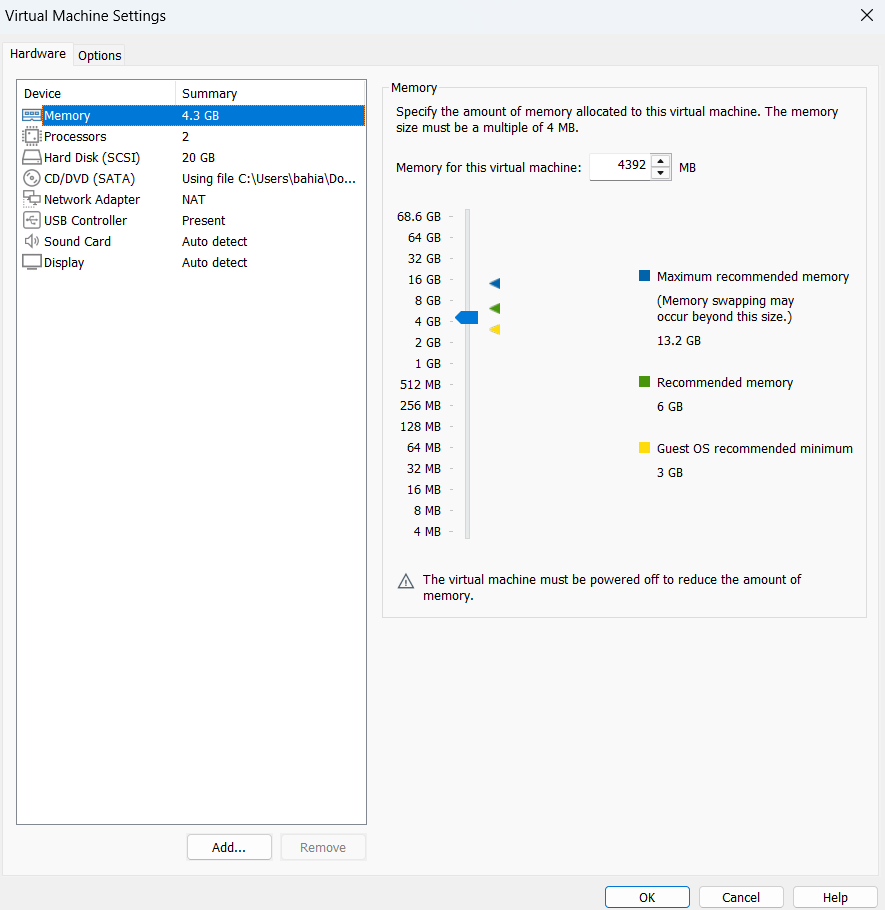

### 02 - Nom d'hôte et adresse IP
Vérification du nom d'hôte (`hostnamectl`) et de l'adresse IP (`ip a`).

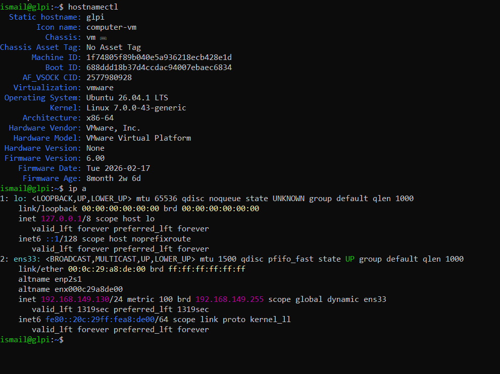

### 04 - Versions de PHP et MariaDB
Vérification des versions installées (`php -v`, `mariadb --version`).

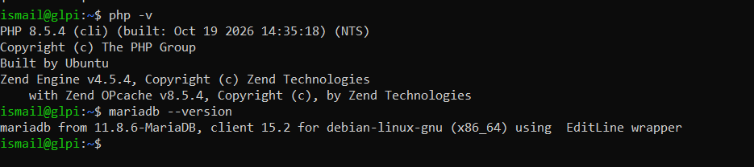

### 05 - État des services
Apache et MariaDB sont actifs (`systemctl status`).

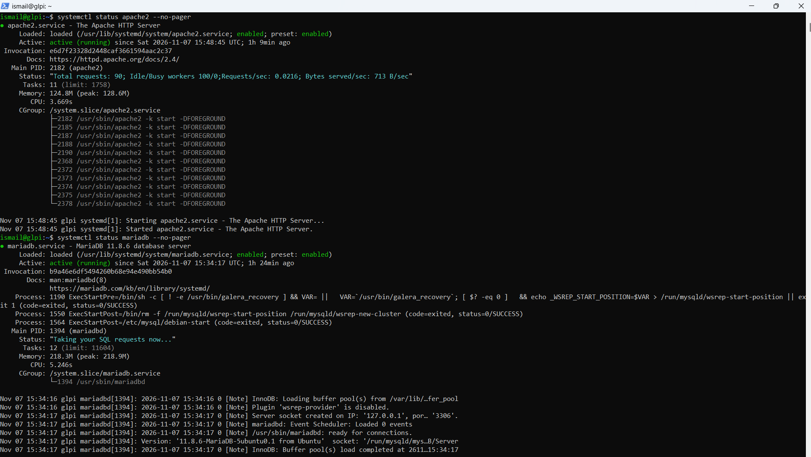

### 06 - Base de données
Liste des bases de données (`SHOW DATABASES;`) avec la base `glpidb`.

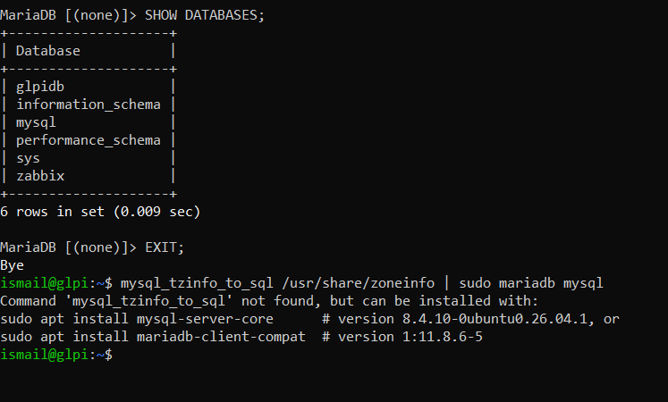

### 07 - Fichiers de GLPI
Contenu du dossier `/var/www/glpi/public` après extraction de GLPI.

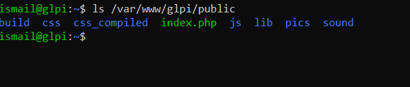

### 08 - Configuration d'Apache
Fichier `glpi.conf` : virtual host vers `/var/www/glpi/public`.

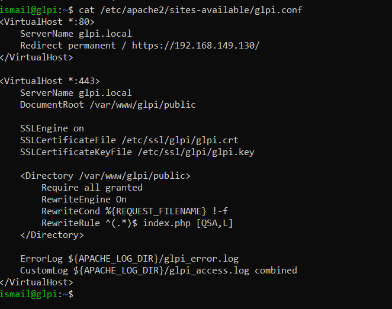

### 09 - Statut d'Apache
Test de configuration (`apache2ctl configtest`) et état du service.

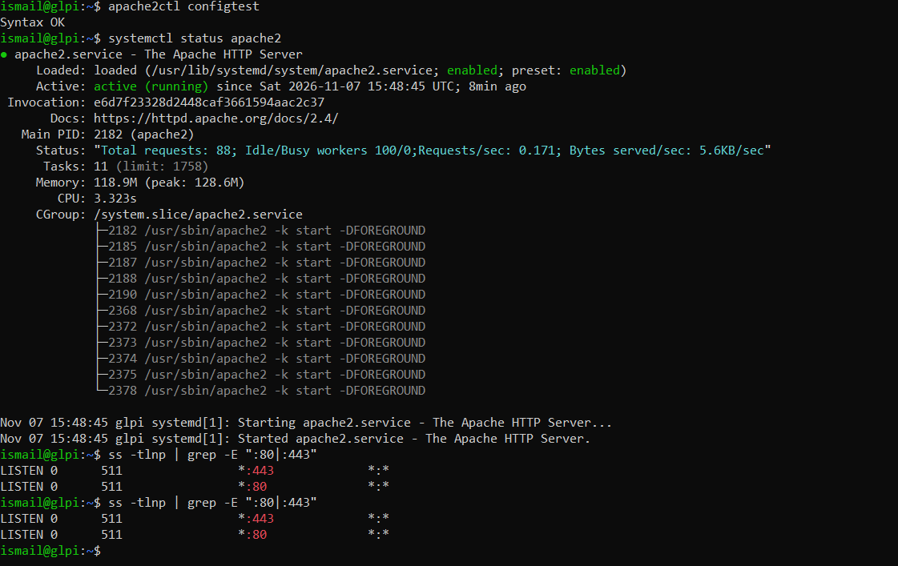

### 10 - Certificat SSL généré
Certificat et clé créés avec OpenSSL dans `/etc/ssl/glpi/`.

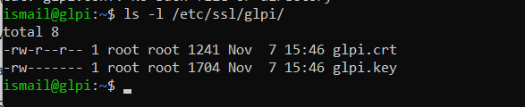

### 11 - Détails du certificat
Certificat auto-signé `glpi.local` (organisation Lab GLPI), valable 825 jours.

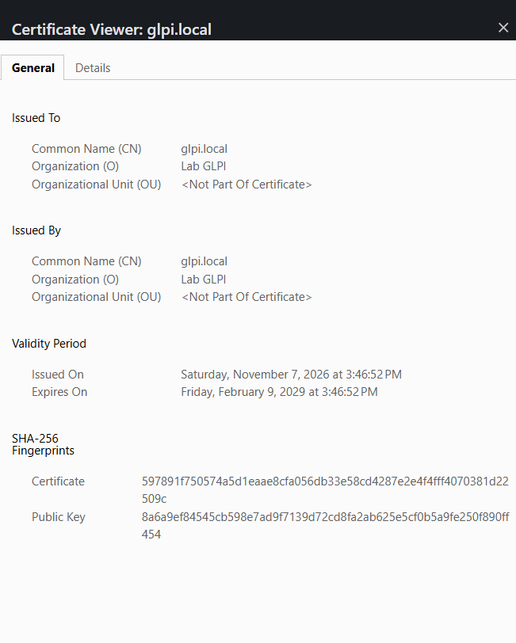

### 12 - GLPI en HTTPS
Accès à GLPI via HTTPS après import du certificat dans Windows.


### 13 - Tableau de bord GLPI
Tableau de bord après installation et désactivation des données de démonstration.

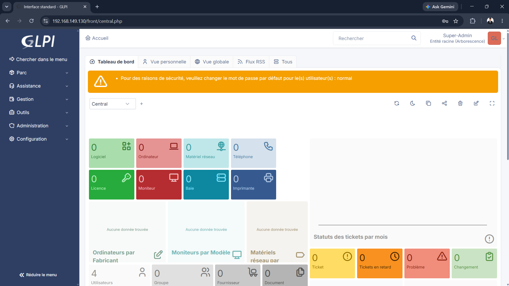

### 14 - Snapshot de la VM
Snapshot VMware réalisé après l'installation.

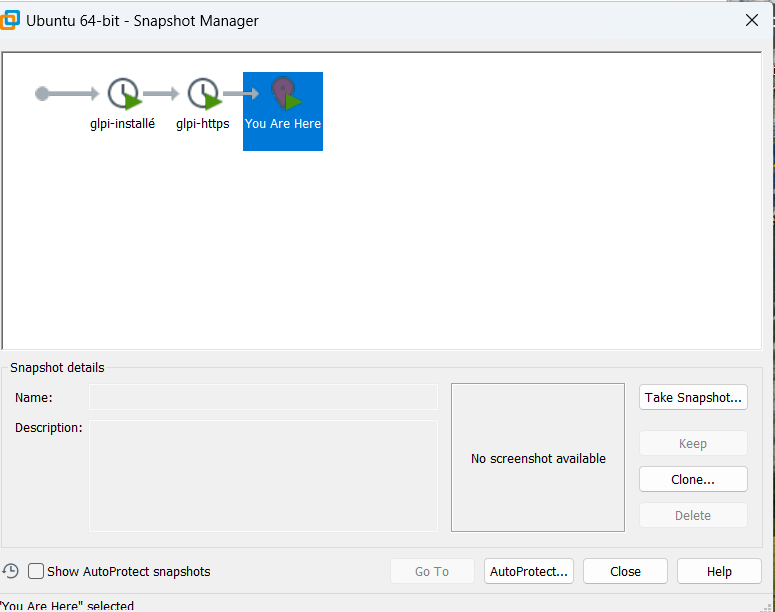

## Commandes principales

```bash
sudo apt update && sudo apt upgrade -y
sudo apt install -y apache2 mariadb-server php libapache2-mod-php \
php-mysql php-curl php-gd php-intl php-xml php-mbstring php-zip \
php-bcmath php-bz2 php-ldap php-apcu php-cli
```

```sql
CREATE DATABASE glpidb CHARACTER SET utf8mb4 COLLATE utf8mb4_unicode_ci;
CREATE USER 'glpiuser'@'localhost' IDENTIFIED BY '<MOT_DE_PASSE>';
GRANT ALL PRIVILEGES ON glpidb.* TO 'glpiuser'@'localhost';
GRANT SELECT ON mysql.time_zone_name TO 'glpiuser'@'localhost';
FLUSH PRIVILEGES;
```

## Problèmes rencontrés et solutions

| Problème | Cause | Solution |
|---|---|---|
| `mysql_secure_installation` introuvable | MariaDB 11.8 est sécurisée par défaut sur Ubuntu | Script devenu facultatif |
| Accès root MariaDB refusé | Mot de passe root hérité d'une ancienne installation | Réinitialisation via `--skip-grant-tables`, puis retour à `unix_socket` |
| Apache inactif | Service arrêté | `systemctl enable --now apache2` |
| Copier-coller impossible dans la console VMware | Limitation de la console | Connexion SSH depuis PowerShell |
| `tar` : fichier introuvable | Mauvais répertoire | Extraction depuis `/tmp` |
| Commande `openssl` multiligne échouée | Collage incomplet | Exécution sur une seule ligne |
| Données de démonstration dans le Dashboard | Option par défaut de GLPI | Désactivation depuis l'interface |

## Compétences mises en œuvre

Linux (Ubuntu Server), Apache, MariaDB, PHP, SSH, OpenSSL / HTTPS, VMware, GLPI, ITSM, documentation technique.
